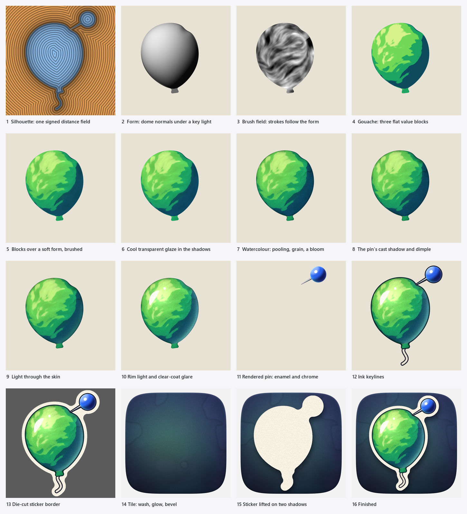

# Gloss Gouache

**The house style of VRAM Bloat Killer's art: a hand-painted subject, lit by rendered light, framed as a die-cut sticker.**

Every image in the style is built from three strata, always in this order and never mixed up:

| Stratum | What it is | How it looks | Made with |
|---|---|---|---|
| **Paint** | the subject's colour and form | gouache value blocks, brushwork, watercolour behaviour, paper | value bands, line-integral brush fields, pigment simulation |
| **Light** | everything light does *on top of* the paint | crisp, physically motivated: glare, rim, light through the skin, cast shadows, rendered metal and enamel | normals, lighting maths, shaped highlights |
| **Frame** | the graphic object the painting lives on | ink keyline, paper sticker border, layered shadows, a washed tile | exact signed distance fields |

The tension between them is the point. The paint is soft and human, the light is sharp and modern, and the frame is clean enough to read at 16 px.

`python tools/make_icons.py --breakdown` regenerates this sheet from the real painter.

## 1. Paint: gouache, then watercolour

**Value before colour.** The form is lit first (panel 2), then split into **three flat value blocks**: shadow, body and light, with a fourth "warm light" block for the brightest areas (panel 4). Their thresholds sit at 27%, 53% and 81% of the light. A block border is soft only across ±2.8% of value, and it is broken up by the brushwork, so the edges read as painted, not stencilled.

**Opaque over soft.** The final paint is 72% flat blocks and 28% continuous form underneath (panel 5), which is what gouache looks like over an underpainting. The blocks keep it graphic; the form under them stops it looking like a posterised photo.

**Brushwork follows the hand and the form.** Strokes are a direction field smeared into marks by line integral convolution (panel 3):
- Near the rim, strokes run along the form's contours, the way you'd wrap a brush round a ball.
- Across the middle, they follow the painter's hand: a loose diagonal, up and to the right at about 30°.
- The angle wanders ±0.35 rad, so no two runs match.
- Marks come at two broad scales. The finest hairline streaks are kept weak, because they read as fur, not paint.

**Temperature split.** Lights shift warm (toward yellow), shadows shift cool (toward blue-teal). Each colour is a five-swatch palette (below). A **cool transparent glaze** (×0.80 red, ×0.88 green, ×1.06 blue) sits over the shadow side at up to 38% (panel 6).

**Watercolour behaviours (panel 7), used sparingly:**
- **Edge pooling:** pigment collects at the wet edge. It's 30% darker over about 11 px (at 1024 px), plus a thin 16% tide line right at the edge.
- **Granulation:** grain settles in the darks only (7.5%), never in the lights.
- **One bloom at most,** and only in shadow: a cauliflower backrun, slightly lighter inside with a darker rim.
- **Paper grain** (2.8%) over everything painted.

## 2. Light: rendered over the paint

Light never replaces paint. It is laid over it, the way varnish and highlights go over a finished painting.

- **One key light,** top-left and in front (direction −0.55, −0.62, 0.56). Every shadow and highlight agrees with it.
- **Cast shadows** from props land *on* the painted surface (panel 8): the pin's shadow falls down and to the right across the balloon, and the dimple where it presses gets its own occlusion.
- **Light through the skin** for anything translucent (panel 9): a band of the palette's light colour glows just inside the edge on the far side. This is what makes a balloon read as rubber and not plastic.
- **Cool rim light** from the right and behind (panel 10), up to 50%, falling off with the angle to the viewer.
- **The clear-coat glare** (panel 10) is designed, not computed. It is a single streak that follows the rim and tapers at both ends, plus one separate glint farther along the same arc, painted in off-white with slightly dry, broken edges, with a faint halo. One glare per object, never a generic round blob.
- **Manufactured things are rendered, organic things are painted** (panel 11). The pin is smooth enamel and chrome: a sphere shaded from its normals with a crisp specular highlight, the balloon's colour bouncing into its shadow side, and a chrome needle with a sharp highlight line. The painted-against-rendered contrast is deliberate.

## 3. Frame: the die-cut sticker

- **Ink keyline** (panel 12) round every separate element. It is about 0.6% of the icon wide (6.5 px at 1024) and uses the palette's own ink colour, never pure black. There are no lines inside the form.
- **Paper sticker border** (panel 13): about 2.5% wide (26 px at 1024), cut round the whole group with its concave corners rounded (34 px), like a real die-cut. It is paper-white, bevelled ±10% toward the key light, with the same grain as the paint.
- **Two shadows lift the sticker** (panel 15): a wide ambient shadow (blur 24, offset 10 right and 30 down, 55%) and a tight contact shadow (blur 5, offset 2 and 7, 35%). Both are tinted deep navy, never black.
- **The tile** (panel 14) is a squircle (exponent 5). It has a deep indigo-to-navy wash with soft teal and violet blooms, a glow of the subject's light colour behind it, a vignette, a highlight along the top inner edge and a shadow along the bottom inner edge.

Every edge comes from a signed distance field (panel 1), so outlines stay crisp at any size and offsets like the border are exact.

## 4. Small sizes

At 32 px and below, the style simplifies instead of shrinking:
- The tile goes. The subject fills the canvas.
- Outlines are sized in *target* pixels, not scaled down:
  - **Dark backgrounds:** a 0.75 px ink keyline plus a 1 px paper border.
  - **Light backgrounds:** a 1.1 px ink outline.
- The app picks the right one from the Windows theme and switches when it changes.
- Paint texture is allowed to vanish. Value blocks, the temperature split and the glare must survive.

## 5. Palettes

Each colour is shadow → body → light → warm light, plus its ink.

| | Shadow | Body | Light | Warm light | Ink |
|---|---|---|---|---|---|
| **Green** (healthy, brand) | `#0E4A5E` | `#1CA463` | `#72D957` | `#D8F28A` | `#06262C` |
| **Amber** (getting full) | `#8E3415` | `#E7861A` | `#FFBE3C` | `#FFEA9C` | `#431B06` |
| **Red** (alert) | `#661036` | `#D9323D` | `#FF6A5A` | `#FFC2A6` | `#38071A` |

Shared across every image:

| What | Colours |
|---|---|
| Paper | `#F7F1E3` |
| Prop ink | `#0D1122` |
| Enamel | `#0E185A` / `#2A5FE8` / `#8AB0FF` |
| Chrome | `#3A404E` → `#F0F3F9` |
| Rim light | `#D8F3FF` |
| Tile | `#2B3360` → `#12142A`, washed with `#1B5A6E` and `#4A2C78` |

A status change swaps only the subject's paint palette. Light, frame, pin and tile never change.

## 6. What it is not

- **Not flat vector.** The subject is always painted, with value blocks and brushwork.
- **Not airbrushed 3D.** Smooth gradients alone are never the form; rendered light only goes over paint.
- **No pure black** anywhere: inks and shadows are deep hues.
- **No grey blotches.** Shadows are cool colour, not grey.
- **No outlines inside the form,** only round it.
- **No texture fighting legibility** at small sizes.
- **No second light source** contradicting the key, and **no round "stock" highlight blobs.**

## 7. Making new art in the style

`tools/make_icons.py` is the reference. A new subject needs:
1. **Shapes** as distance fields (`scene`).
2. **A palette** in the five-swatch format.
3. **The same stage order:** form → brush field → value blocks → gouache → glaze → watercolour → cast shadows → light through → rim and glare → rendered props → keylines → die-cut → shadows → tile.

The emergency panel's artwork (`tools/make_emergency_art.py`) predates the style and is plain glossy illustration. It is the next candidate for a Gloss Gouache repaint.
